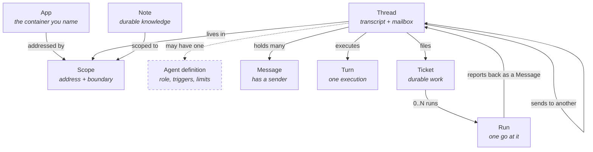
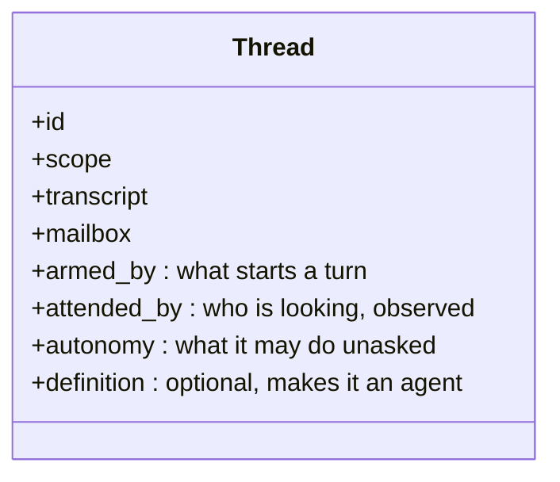
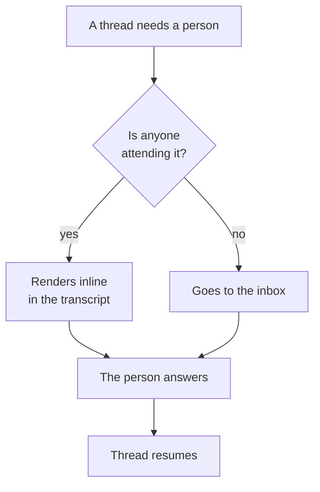
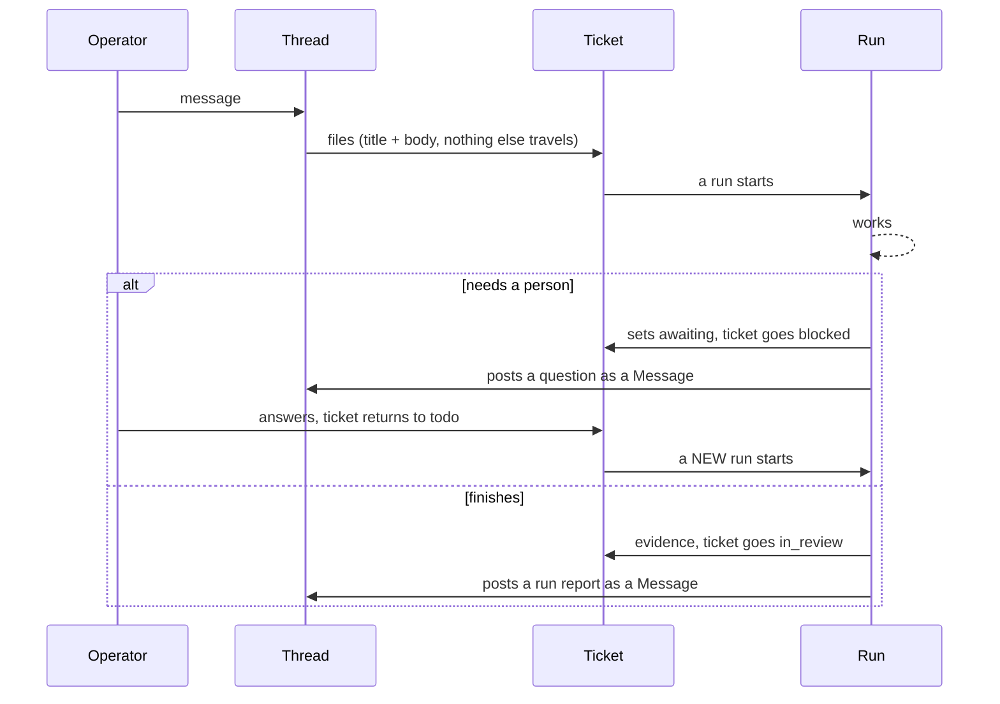
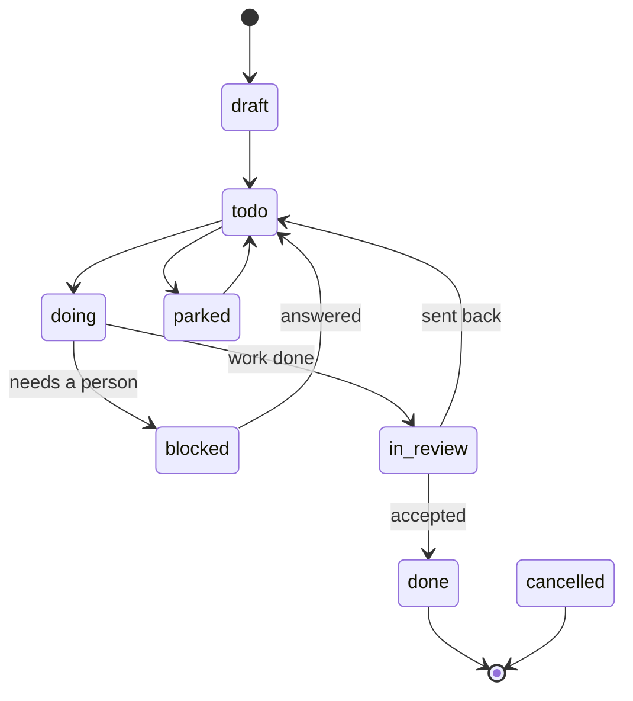
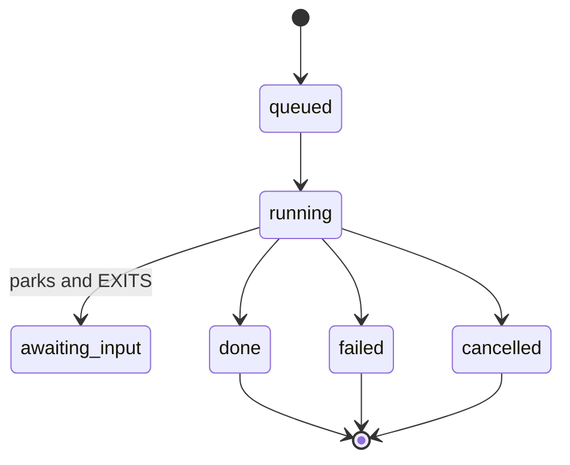
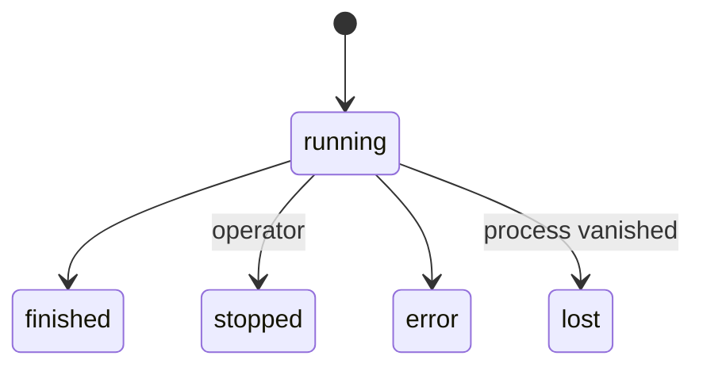
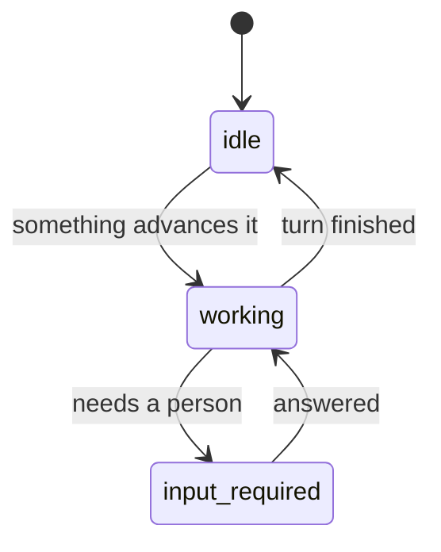

# The schema, on one page

**Date:** 2026-08-27
**Status:** describes the model proposed in
`one-thread-many-senders-2026-08-27.md`. Every diagram marks what is BUILT and
what is PROPOSED, because this corpus has a long record of the two being
indistinguishable in a document.

## 1. The entities

Nine things. Everything else in Workshop is a view over these.

| Entity | One line | State |
|---|---|---|
| **App** | The container you name. The only object a person points at. | BUILT (partly; see §7) |
| **Scope** | An address, and the access boundary. Broader than App: see §1.1. | BUILT, in five incompatible grammars |
| **Thread** | A transcript plus a mailbox. Chats and agents are both threads. | PROPOSED as one entity; two forked implementations exist |
| **Message** | One entry in a transcript. Has a **sender**. | BUILT, without a sender field |
| **Turn** | One execution of the model over a thread's transcript. | BUILT |
| **Agent definition** | A name, a role, triggers, limits. A thread may have one. | BUILT (`agents/*.md`) |
| **Ticket** | The durable work item, and the unit of approval. | BUILT |
| **Run** | One go at a ticket. Immutable once closed. Code still says `job`. | BUILT |
| **Note** | Durable scoped knowledge. | BUILT |

The dashed edge is the whole difference between a chat and an agent. The
`Thread -> Thread` edge is the one thing that does not exist today.

### 1.1 Scope and App are not the same thing, and merging them is not the fix

`app-is-the-entity-2026-08-20.md` says scope is "a derived address for an app,
not a parallel concept." **Measured on this tree, all three clauses of that are
false**, and the reason is the platform's own repo:

- `development` is **143 of 200 chat threads and 333 of 348 tickets**, and it is
  explicitly not an App: `backend/services/app_links.py:45` excludes it as
  `_SELF_PROJECT_SLUG`.
- `workshop` has no app record and no project entry either.
- `role:reviewer`, `agent:masini` and `global` correspond to no app by design.

So Scope is a **superset** of App and cannot fold into it. Scope is also not
derived: it is authored by hand in at least six pickers, including a free-text
`scope: str` field on the ticket-create request body
(`backend/routes/tasks_all.py:556`).

The real problem is not scope-versus-app. It is that **five different addressing
grammars are live at once**, three of them reusing the same `app:` and
`project:` prefixes with different resolvers:

1. **scope** (`scope_tree.py:115`) — `workshop`, `development`, `project:`,
   `app:`, `agent:`, `role:`
2. **context_key** (`scope_tree.py:175`) — `""`, `general`, `workshop`,
   `new-project`, bare app ids
3. **workspace** (`app_files.py:246`) — `app:`, `project:`, `documents`
4. **ref** (`refs.py:40`) — nine kinds, including both `doc` and `file`, both
   `project` and `app`, and `run` where the store says `job`
5. **learnings scope** (`learnings.py:194`) — adds `global`, and carries both
   `development` and `project:development` for the same place

The damage is measurable: `general`, which is a *context_key*, sits in the
semantic index's *scope* column **1,374 times**. Going from five grammars to one
is the fix. Merging Scope into App is not, and would not have caught this.

## 2. What a Thread is

A Thread is an id, a scope, a transcript, and a mailbox. It is **addressable**:
anything can send to it, and who sent is a field on the message rather than a
property of the thread.

Its fields, with the three that replace the chat/agent distinction marked:

`armed_by`, `attended_by` and `autonomy` are the three axes. They are **fields
on one entity**, not a type, and each controls exactly one thing:

- **`armed_by`** — empty means only a person starts a turn here. Non-empty means
  a trigger, its own continuation, or another thread can. This is the only field
  that decides whether the thread can work while you are away.
- **`attended_by`** — observed live, never stored. Decides one thing: does a
  question render inline or go to the inbox.
- **`autonomy`** — the existing per-agent enum, unchanged.

**A chat** is `armed_by` empty, a person attending.
**An agent** is `armed_by` non-empty, a definition present, nobody attending.
Chatting with an agent changes `attended_by` and nothing else.

### 2.1 This is a deletion, not an addition

The objection to answer is "three new fields is more schema, not less." It is
not, because the three inert enums they replace are already there and already
measured not to work:

- `CHAT_MODES = (direct, orchestrated, auto)`. On 200 real threads: `auto` 84,
  `direct` 72, `orchestrated` 44. **`orchestrated` and `auto` differ only in
  prompt text** (`chat_context.py:945-960`). `direct` gates exactly one code
  path. So **128 of 200 threads sit on a distinction that is a paragraph of
  English.**
- A second, unreconciled mode vocabulary (Direct/Delegated) is live in the
  design record beside it.
- `latitude` survives in 20+ files and is set on 1 of 348 tickets.

Three enums that gate nothing, out; three fields that each gate one thing, in.

Why "armed" and not "a mode": a thread you opened by typing was never armed, so
it cannot work ahead while you are away. There is no switch to leave in the
wrong position and no ceremony to keep it off. The mechanism already exists and
runs in production: `chat_drain.request_continuation` persists a seed and
`continuation_loop` starts the turn once the thread is idle.

## 3. Who can send

Four of the five senders are built. The dashed one is the missing primitive.

Sends carry an urgency, and the vocabulary is already correct in
`backend/services/control.py`:

- **steer** — goes into the turn that is running now.
- **queue** — waits for the next turn.

## 4. Where a question goes

This is the only thing attendance decides.

Today the producer guesses this at write time and stamps `meta.autonomous`.
`frontend/src/lib/chat.ts:250` already justifies that render tier with the
words "with nobody watching", so the concept is in the code without a name.

Honest caveat: that flag is set on **2 of 2,699 messages**. The evidence that
attendance is already a concept here is the comment and the render tier, not
the usage. Read it as a naming argument, not as a claim that the mechanism is
load-bearing today.

The delivery rule, which ships and is correct, is from
`one-fact-one-place-2026-08-22.md` §4: a message goes inline only if its
provenance names this thread **and** it is waiting on a person. A notify never
goes inline, ever.

## 5. How work moves

Two things to hold onto:

- **A ticket carries its whole spec.** A run reads the title and body and
  nothing else. Not the chat, not the operator, not the agent that filed it.
- **A blocked run does not resume.** It ends. Answering the ticket starts a new
  run. This is settled (`blocked-and-escalate-flow-2026-07-18.md` §5.1) and it
  is why the ticket, not the run, is the durable thing.

## 6. The state machines

All three are the enums that are actually in the code today.

**Ticket** (`backend/services/tasks.py:150`):

**Run** (`backend/services/jobs.py:52`):

`awaiting_input` is a park-and-exit, not a suspend: the process is already gone
when the status is written. That is deliberate, and it is the difference
between this and a durable-execution engine.

**Turn** (`backend/db/models.py:1399`):

**Thread** has no stored status today. Under this model it needs the A2A
vocabulary, which is three values and not a new invention:

`input-required` is *interrupted*, not terminal. That is the point: the thread
is the same object before, during and after the pause.

## 7. What is not true yet

Stated plainly so nobody reads this page as a description of the tree.

- **Thread is not one entity in code.** Chats and agent runs have three storage
  backends, three separate `claude` invocations and three prompt assemblers. A
  run has no transcript at all.
- **Message has no sender field.** Roles are `user` and `assistant` only. There
  is no system or event role. Platform writes are `assistant` plus
  `meta.autonomous`.
- **Nothing but a human can open a thread.** `chat_store.create_thread` has one
  caller.
- **Thread to Thread does not exist**, in the code or anywhere in the design
  corpus.
- **App and Project are still two registries.** The migration in
  `app-is-the-entity-2026-08-20.md` §9 is not built.
- **Three unreconciled mode vocabularies** are live at once. The next move on
  modes is deletion, not addition.

## 8. The one thing to build

A thread can send to a thread: a real endpoint, `sender` on the message,
through the existing `chat_queue` door. Successor links, the triager, and
cross-thread nudges all fall out of it. Everything else on this page is naming
something that already exists.

## 9. Audit: what the schema is carrying, measured 2026-08-27

A full tree-shake against the live stores (Postgres, `.runtime/jobs.jsonl` at
5,855 distinct jobs, 44 `.tasks.json` files at 215 records, 25 agent
definitions, 15,909 index chunks). The entities above are close to right. What
the tree is carrying is five addressing grammars (§1.1), four stores for two
entities, and a field graveyard from three abandoned migrations.

### 9.1 Confirmed dead: written by nothing, or always null

Every count below is measured, not inferred.

- **The `run` table**: 0 rows, 0 production call sites. Its only importers are
  a `skipif` test. It was already dropped once for "2,753 rows, zero readers"
  and re-created empty.
- `chat_message.scope_from` / `scope_to`: 0 of 2,699
- `chat_turn.agent_slug`: 0 of 1,050. `chat_thread.agent_slug`: 0 of 200.
- `chat_thread.permission_mode`: 0 of 200. `scope_locked`: 0 of 200.
- `ticket.parent_id`, `ticket.app_id`, `ticket.lease_until`, `ticket.claim_pid`:
  0 of 348 each
- **`job.budget`**: declared in `jobs.py:23`, never written once in 5,855 jobs
- 14 `.tasks.json` keys empty on all 215 records, including `awaiting`,
  `provenance`, `discovered_from`, `latitude`, `type`
- 7 agent frontmatter fields parsed by `agents_registry` and carried by 0 of 25
  definition files, including `autonomy` and `latitude`
- `job.kind`: 5 of 6 declared enum values never occur, and the one value that
  does occur most (`background`) **is not in the declared enum**
- `.runtime/agent-runs-pending.jsonl`: has a live writer, 0 bytes since
  2026-05-20

### 9.2 Effectively dead: the concept never took

- `ticket.latitude` 1 of 348, `ticket.max_attempts` 1 of 348,
  `ticket.acceptance` 7 of 348, `ticket.awaiting` 3 of 348
- `job.chat_id` 9 of 5,855
- `job.status = awaiting_input` 3 raw lines of 11,957; `queued` never written
- `chat_message.meta.autonomous` 2 of 2,699

### 9.3 Dual language, ranked by confusion removed per unit of work

1. **note / memory / knowledge / learning.** Four names, and the only pair
   visible on one screen: the page is titled "Memory", its component is called
   `Notes`, its button says "New note", its directory is `shared/knowledge/`,
   and there is a **second store** (`learnings`, 84 records) for the same
   concept that neither the Memory page nor this document mentions. Four API
   prefixes. **No ADR blocks this one**, and the frontend only knows the word
   `knowledge` in 28 places.
2. **task / ticket.** Store is both, split by scope. API says `task`, UI says
   `ticket`. This one is **deliberate and frozen**, not drift: ADR 0028 covers
   operator-visible names only, and a handoff says "do not start task -> ticket."
3. **job / run.** Store and API say `job`, UI says `run`, and the whole
   translation is three client-side lines. Blocked, though: `run_id` already
   means two other things (the deploy runner, the sweep control channel). Two
   further names for the same object exist: "background run" and "pending run".
4. **document / doc / file / workspace.** `MemoryDocument.tsx` reads the same
   file through two different APIs, and a third door still exists. The "Files"
   tab on the Memory page is not the files API at all; it is chat attachments.
5. **chat / thread.** Fine as is. Namespace plus resource, done correctly. The
   string "Thread" appears zero times in the frontend. Do not touch it.

### 9.4 Structurally wrong: needs a decision, not a rename

- **Five registries for "the container you name":** `apps.json` (8),
  `installed-apps.json` (**the same 8 ids and nothing else**), `projects.json`
  (7), Postgres `app` (9), Postgres `project` (2). The UI teaches the split
  rather than hiding it ("Backed by a project" / "No backing project yet").
- **A stale shadow store:** `/workspace/.tasks.json` holds 126 records last
  written 2026-08-25, while Postgres holds 333 for the same scope. It sits at
  the repo root under the name every script still knows.
- **`role:` is a scope kind that is not in the scope tree.** It parses as a
  scope, labels as a scope, renders at the root of the Memory tree beside real
  scopes, and gets a prompt layer, while `scope_tree.py:267` explicitly returns
  `None` for it. In production it holds **two files, hand-committed once on
  2026-07-31**, and occurs twice in a 15,909-chunk index.
- **`Documents` is a synthetic UI node**, hardcoded as a root sibling of real
  scopes, whose children are filesystem paths rather than scope/id pairs. So the
  Memory tree's root mixes three address kinds with no visual distinction.
- **Agents own ticket queues that have never held a ticket:** three
  `.runtime/agent-scopes/` dirs, each with a TODO, a store and a lock, all
  holding zero tasks.

### 9.5 A named-app dependency the purity gate cannot see

`~/notes` is hardcoded in platform source: `services/permissions.py:86`
(`NOTES_VAULT_ROOT`, module-level, `Path.home() / "notes"`),
`services/stores.py:292`, `services/notes_vault.py:31`. It is operator-visible
(`Memory.tsx:1381` renders `~/notes` and names Obsidian) and model-visible
(`workshop_query_server.py:85`).

`scripts/check_no_app_names.py` **does not count any of it**, for three
independent reasons, all confirmed by reading the script: its alphabet is the 8
app ids from `roster()` and the word "obsidian" is not in it; `notes_vault.py`
matches the path pattern that files it as app *content* and skips inspection;
and the literal is `"notes"`, which the `notes-app` patterns do not match and
the `_AMBIGUOUS` list would suppress anyway.

So an absolute path into the operator's home directory, naming a third-party
editor, sits in `backend/services/permissions.py` and is **structurally
invisible to the gate that exists to catch exactly this**. It is an uncounted
violation, not a counted one, which is why the three counts have stayed clean
while the problem persisted.

### 9.6 Explicitly fine

Said out loud, because a list of problems reads as if everything is broken:
`chat`/`thread` naming, the ticket state machine (8 states, 7 populated),
`chat_turn` (all 5 statuses exercised; its own `run_id -> turn_id` rename
already landed cleanly), `job.trigger` (all 4 values used), RLS tenancy (the
healthiest part of the schema: documented, asserted at engine construction,
pinned by tests), and the `workshop:` ref grammar as a design. That last one is
under-used, not wrong.
