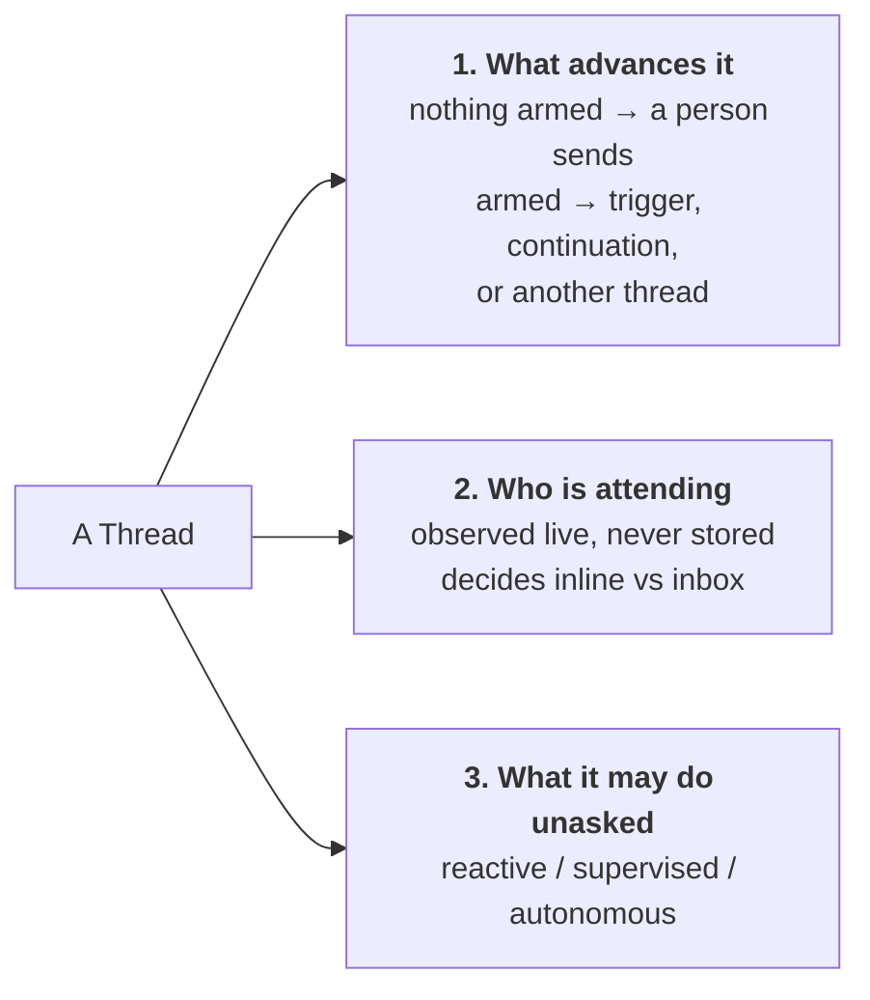
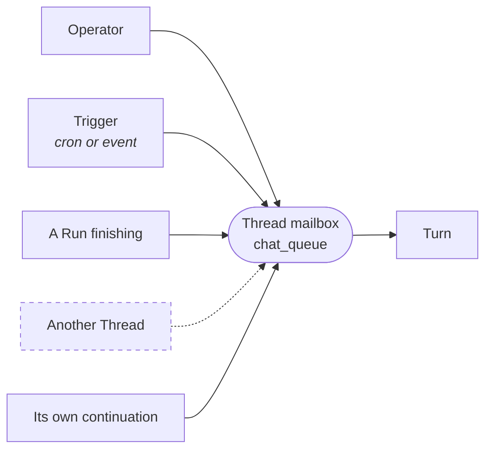
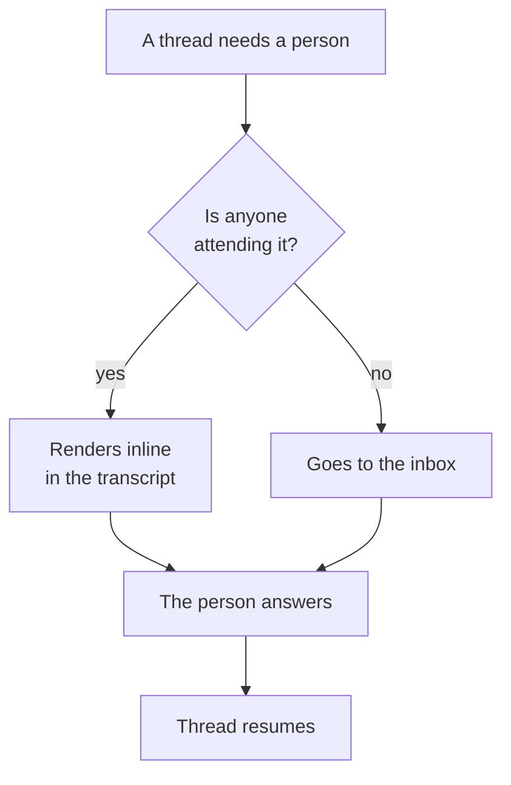
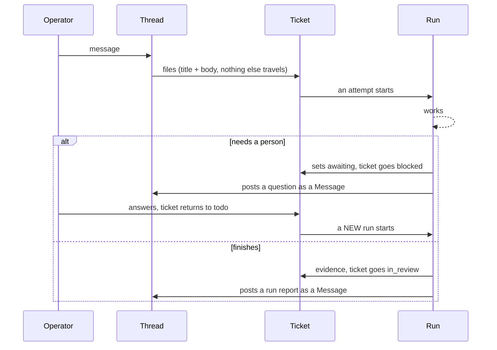
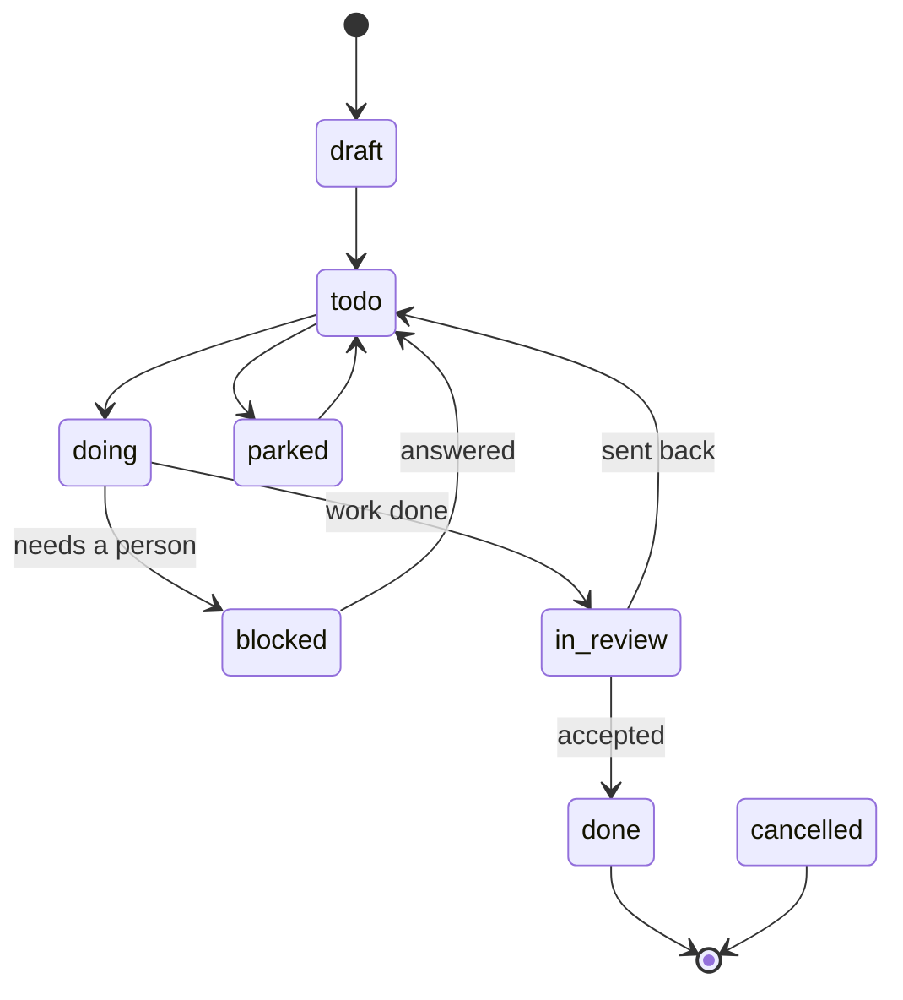
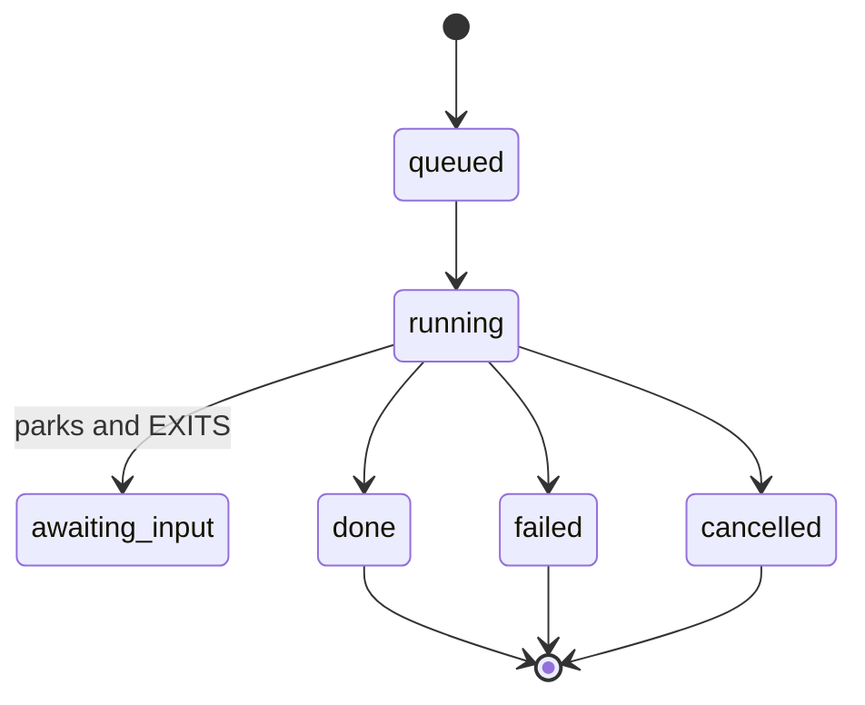
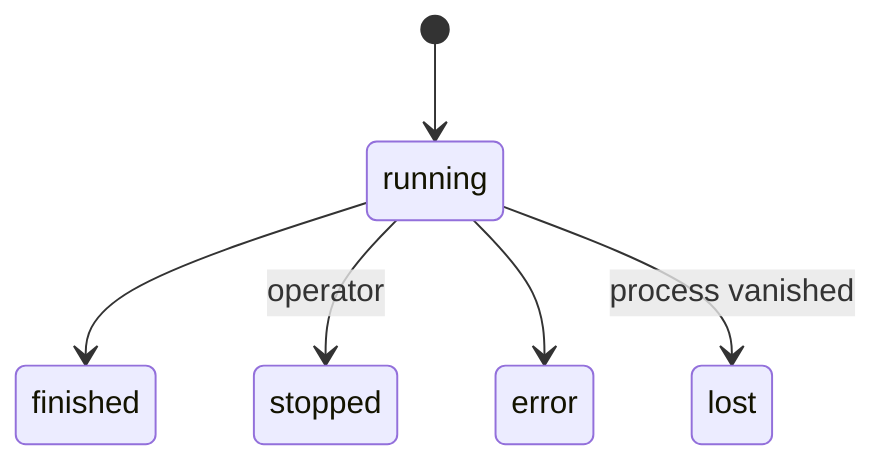
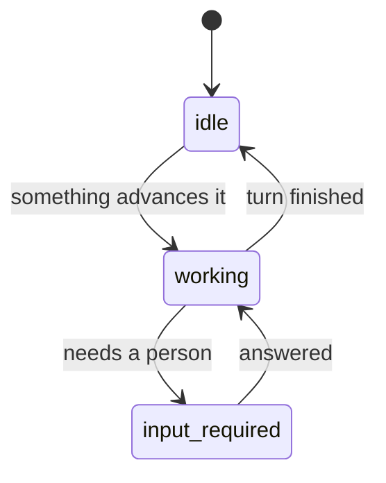

# The schema, on one page

**Date:** 2026-08-27
**Status:** describes the model proposed in
`one-thread-many-senders-2026-08-27.md`. Every diagram marks what is BUILT and
what is PROPOSED, because this corpus has a long record of the two being
indistinguishable in a document.

## 1. The entities

Nine things. Everything else in Workshop is a view over these.

| Entity | One line | State |
|---|---|---|
| **App** | The container you name. The only object a person points at. | BUILT (partly; see §7) |
| **Scope** | An app's internal address, and the access boundary. Never in the UI. | BUILT |
| **Thread** | A transcript plus a mailbox. Chats and agents are both threads. | PROPOSED as one entity; two forked implementations exist |
| **Message** | One entry in a transcript. Has a **sender**. | BUILT, without a sender field |
| **Turn** | One execution of the model over a thread's transcript. | BUILT |
| **Agent definition** | A name, a role, triggers, limits. A thread may have one. | BUILT (`agents/*.md`) |
| **Ticket** | The durable work item, and the unit of approval. | BUILT |
| **Run** | One attempt to work a ticket. Immutable once closed. | BUILT |
| **Note** | Durable scoped knowledge. | BUILT |

The dashed edge is the whole difference between a chat and an agent. The
`Thread -> Thread` edge is the one thing that does not exist today.

## 2. What a Thread is

A Thread is an id, a scope, a transcript, and a mailbox. It is **addressable**:
anything can send to it, and who sent is a field on the message rather than a
property of the thread.

Three independent facts vary. None of them is a type.

**A chat** is a thread with nothing armed and a person attending.
**An agent** is a thread with a declared definition and something armed, with
nobody attending.

Neither is a type. Chatting with an agent changes fact 2 and nothing else.

Why "armed" and not "a mode": a thread you opened by typing was never armed, so
it cannot work ahead while you are away. There is no switch to leave in the
wrong position and no ceremony to keep it off. The mechanism already exists and
runs in production: `chat_drain.request_continuation` persists a seed and
`continuation_loop` starts the turn once the thread is idle.

## 3. Who can send

Four of the five senders are built. The dashed one is the missing primitive.

Sends carry an urgency, and the vocabulary is already correct in
`backend/services/control.py`:

- **steer** — goes into the turn that is running now.
- **queue** — waits for the next turn.

## 4. Where a question goes

This is the only thing attendance decides.

Today the producer guesses this at write time and stamps `meta.autonomous`.
`frontend/src/lib/chat.ts:250` already justifies that render tier with the
words "with nobody watching", so the concept is in the code without a name.

The delivery rule, which ships and is correct, is from
`one-fact-one-place-2026-08-22.md` §4: a message goes inline only if its
provenance names this thread **and** it is waiting on a person. A notify never
goes inline, ever.

## 5. How work moves

Two things to hold onto:

- **A ticket carries its whole spec.** A run reads the title and body and
  nothing else. Not the chat, not the operator, not the agent that filed it.
- **A blocked run does not resume.** It ends. Answering the ticket starts a new
  run. This is settled (`blocked-and-escalate-flow-2026-07-18.md` §5.1) and it
  is why the ticket, not the run, is the durable thing.

## 6. The state machines

All three are the enums that are actually in the code today.

**Ticket** (`backend/services/tasks.py:150`):

**Run** (`backend/services/jobs.py:52`):

`awaiting_input` is a park-and-exit, not a suspend: the process is already gone
when the status is written. That is deliberate, and it is the difference
between this and a durable-execution engine.

**Turn** (`backend/db/models.py:1399`):

**Thread** has no stored status today. Under this model it needs the A2A
vocabulary, which is three values and not a new invention:

`input-required` is *interrupted*, not terminal. That is the point: the thread
is the same object before, during and after the pause.

## 7. What is not true yet

Stated plainly so nobody reads this page as a description of the tree.

- **Thread is not one entity in code.** Chats and agent runs have three storage
  backends, three separate `claude` invocations and three prompt assemblers. A
  run has no transcript at all.
- **Message has no sender field.** Roles are `user` and `assistant` only. There
  is no system or event role. Platform writes are `assistant` plus
  `meta.autonomous`.
- **Nothing but a human can open a thread.** `chat_store.create_thread` has one
  caller.
- **Thread to Thread does not exist**, in the code or anywhere in the design
  corpus.
- **App and Project are still two registries.** The migration in
  `app-is-the-entity-2026-08-20.md` §9 is not built.
- **Three unreconciled mode vocabularies** are live at once. The next move on
  modes is deletion, not addition.

## 8. The one thing to build

A thread can send to a thread: a real endpoint, `sender` on the message,
through the existing `chat_queue` door. Successor links, the triager, and
cross-thread nudges all fall out of it. Everything else on this page is naming
something that already exists.
